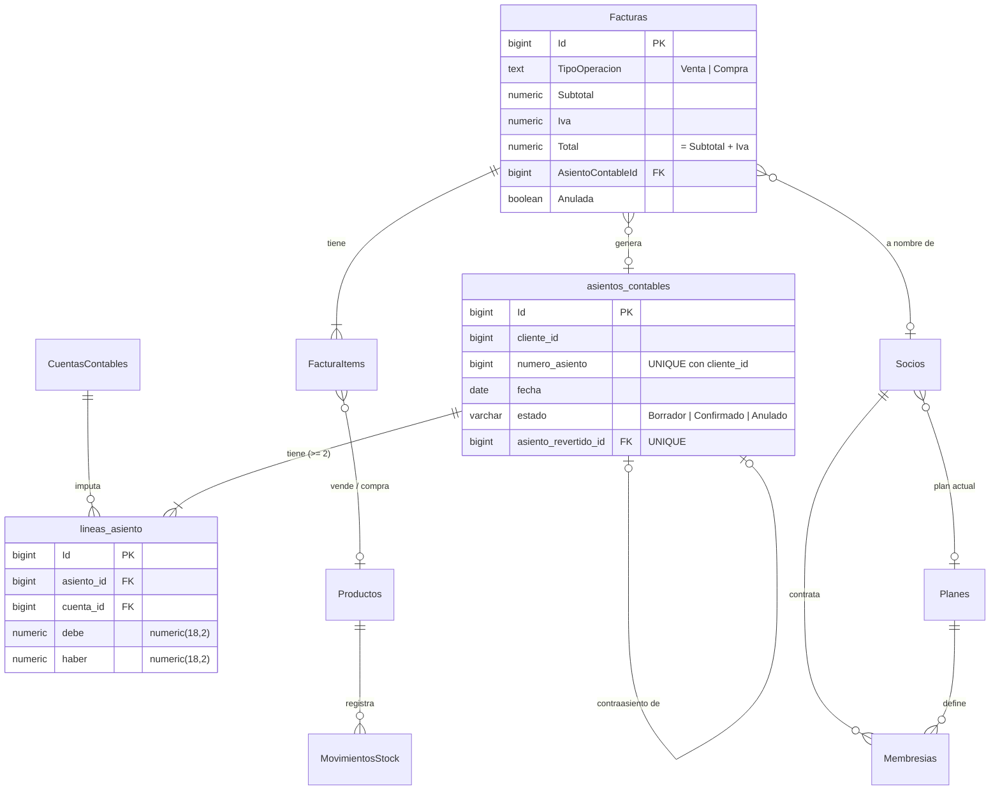

# Base de datos

PostgreSQL. El esquema lo crean las **migraciones de EF Core**
(`backend/src/EstudioContable.Infrastructure/Migrations`), que se aplican solas al
arrancar el backend. Los objetos que EF no sabe generar (triggers, funciones y la
vista) están escritos en SQL en
[`SqlObjetosDeBaseDeDatos.cs`](../backend/src/EstudioContable.Infrastructure/Migrations/SqlObjetosDeBaseDeDatos.cs)
y los aplica la migración `ObjetosDeBaseDeDatos`. De esa forma, lo que se presenta es
exactamente lo que corre.

- Esquema completo generado con `pg_dump`: [`01_esquema_base_datos.sql`](../01_esquema_base_datos.sql)
- Diseño inicial, previo a la implementación: [`diseno_inicial_esquema.sql`](diseno_inicial_esquema.sql)
- Pruebas de las reglas directo contra la base: [`pruebas_base_de_datos.sql`](pruebas_base_de_datos.sql)

## Esquemas

| Esquema | Contenido |
|---|---|
| `contabilidad` | Plan de cuentas, asientos y líneas, facturas, socios, planes, membresías, usuarios, auditoría |
| `caja` / `banco` | Movimientos de tesorería |
| `inventario` | Productos y movimientos de stock |
| `ventas` / `compras` | Facturas de venta y compra del módulo con detalle (legado) |

## Modelo principal



## Integridad

Las reglas de negocio están en el dominio (C#) **y también en la base**, para que no
se puedan saltear con un `INSERT` o `UPDATE` directo.

### Restricciones `CHECK`

| Tabla | Restricción | Regla |
|---|---|---|
| `lineas_asiento` | `CK_lineas_asiento_importes_no_negativos` | `debe >= 0 AND haber >= 0` |
| `lineas_asiento` | `CK_lineas_asiento_debe_o_haber` | La línea va al Debe **o** al Haber, nunca a los dos ni a ninguno |
| `Facturas` | `CK_Facturas_TotalEsSubtotalMasIva` | `Total = Subtotal + Iva` |
| `Facturas` | `CK_Facturas_ImportesNoNegativos` | Subtotal e IVA no negativos |
| `Productos` | `CK_Productos_StockNoNegativo` | `StockActual >= 0` |
| `Planes` | `CK_Planes_Valores` | Duración > 0 y precio >= 0 |
| `Membresias` | `CK_Membresias_Vigencia` | Vencimiento >= inicio |
| `movimientos_caja` / `movimientos_banco` | `CK_..._importe_positivo` | `Importe > 0` |

### Únicas y claves foráneas

- `asientos_contables (cliente_id, numero_asiento)` único: no se repite la numeración.
- `asientos_contables (asiento_revertido_id)` único: un asiento se revierte una sola vez.
- `Usuario (Email)` único: es el nombre de usuario del login.
- Las FK `lineas_asiento → CuentasContables`, `Facturas → asientos_contables` y
  `FacturaItems → Productos` son `RESTRICT`: no se puede borrar algo que está referenciado.

## Triggers

| Trigger | Tabla | Momento | Qué hace |
|---|---|---|---|
| `trg_validar_balance_lineas` / `trg_validar_balance_asiento` | `lineas_asiento`, `asientos_contables` | `AFTER`, **diferido** al `COMMIT` | Un asiento Confirmado debe cumplir la partida doble: Debe = Haber, más de 0 y al menos 2 líneas |
| `trg_proteger_lineas_asiento` / `trg_proteger_asiento` | `lineas_asiento`, `asientos_contables` | `BEFORE UPDATE OR DELETE` | Un asiento Confirmado o Anulado es inmutable: no se borra, no vuelve a Borrador y sus líneas no cambian |
| `trg_auditar_*` (7 tablas) | Facturas, asientos, cuentas, usuarios, planes, socios, productos | `AFTER INSERT OR UPDATE OR DELETE` | Registra el cambio en `contabilidad.auditoria` |
| `trg_auditoria_solo_lectura` / `trg_auditoria_sin_truncate` | `auditoria` | `BEFORE UPDATE OR DELETE` / `BEFORE TRUNCATE` | La auditoría no se puede alterar |

**¿Por qué el trigger de balance es diferido?** Al confirmar una factura se inserta
el asiento y después sus líneas, dentro de la misma transacción. Si se validara fila
por fila, el asiento estaría "desbalanceado" entre una línea y la siguiente. Con
`DEFERRABLE INITIALLY DEFERRED`, la validación corre una sola vez al hacer `COMMIT`,
con el asiento completo. Si no balancea, se revierte toda la transacción.

**¿Cómo se corrige un asiento confirmado?** Con un contraasiento: mismas cuentas e
importes con Debe y Haber invertidos (`asiento_revertido_id` apunta al original).
Es lo que hace el sistema al anular o editar una factura.

## Auditoría

```
Usuario logueado ──JWT──▶ API ──▶ interceptor de EF: set_config('app.usuario', email)
                                         │
                                         ▼
               INSERT/UPDATE/DELETE en tabla auditada ──▶ trigger fn_auditar()
                                                                │
                                                                ▼
                                                  contabilidad.auditoria
```

- `fn_auditar()` guarda la fila **antes y después** (`jsonb`), la lista de
  `campos_modificados`, la tabla, la operación, el usuario y la fecha.
- El usuario sale de `current_setting('app.usuario')`, que la API completa en cada
  conexión ([`AuditoriaConnectionInterceptor`](../backend/src/EstudioContable.Infrastructure/Persistence/AuditoriaConnectionInterceptor.cs)).
  Si el cambio se hace desde un cliente SQL, se registra el usuario de PostgreSQL.
  Como el trigger está en la base, audita cualquier cambio, venga de donde venga.
- Nunca se guarda el hash de la contraseña. Un cambio de contraseña figura como
  campo `Contraseña`, y los inicios de sesión no generan registros.
- Se consulta desde la pantalla **Auditoría** (solo administradores) o con
  `GET /api/auditoria`.

## Vista y función

**`contabilidad.v_libro_mayor`**: totales de Debe, Haber y saldo por cuenta, tomando
solo los asientos confirmados. La usa `GET /api/asientos/mayor`.

**`contabilidad.fn_sumas_y_saldos(cliente, desde, hasta)`**: balance de sumas y
saldos entre fechas (opcionales). Devuelve todas las cuentas con el saldo expresado
según su naturaleza: Debe − Haber para el Activo, Haber − Debe para Pasivo,
Patrimonio Neto y Resultado. La usan el Balance General (`GET /api/balance`) y el
reporte PDF de Balance.

```sql
SELECT codigo, nombre, saldo_natural
FROM contabilidad.fn_sumas_y_saldos(1, '2026-01-01', '2026-12-31')
WHERE saldo_natural <> 0;
```

## Índices

Además de las PK y de un índice por cada FK, se destacan:

- `asientos_contables (cliente_id, fecha)`: listados del Libro Diario por período.
- `asientos_contables (cliente_id, numero_asiento)` único.
- `lineas_asiento (cuenta_id)`: agregaciones del Mayor y del Balance.
- `auditoria (fecha)` y `auditoria (tabla, registro_id)`: consultar el historial de un registro.

## Transacciones

- Crear, anular o editar una factura toca el asiento, la tesorería y el stock en una
  sola transacción (`FacturacionService`). Si algo falla, no queda nada a medias.
- El cobro de una membresía abre su propia transacción y la facturación participa
  de ella, en lugar de abrir otra.

## Corrección de datos heredados

La migración `ObjetosDeBaseDeDatos`, antes de crear las restricciones, corrige datos
de versiones anteriores que las violaban:

- Borra dos cuentas duplicadas sin movimientos: una "Caja" cargada como Pasivo y
  "IVA a Pagar".
- Pone 1 mes a los planes con duración 0 (quedaron así al renombrar `DuracionDias`
  a `DuracionMeses`).
- Corrige membresías con el vencimiento microsegundos antes del inicio (error de
  cálculo ya corregido en el código).
- Anula referencias huérfanas antes de crear las FK nuevas.

## Cómo probar las reglas

```bash
psql -U postgres -d EstudioContableDB -f docs/pruebas_base_de_datos.sql
```

Intenta violar cada regla (asiento desbalanceado, modificar uno confirmado, factura
con total incorrecto, stock negativo, borrar la auditoría, etc.) e imprime `OK` o
`FALLA` por cada caso. Todo corre dentro de bloques que se deshacen, así que no deja
datos en la base.

## Regenerar `01_esquema_base_datos.sql`

Sobre una base con todas las migraciones aplicadas:

```bash
pg_dump -U postgres -d EstudioContableDB --schema-only --no-owner --no-privileges > 01_esquema_base_datos.sql
```
