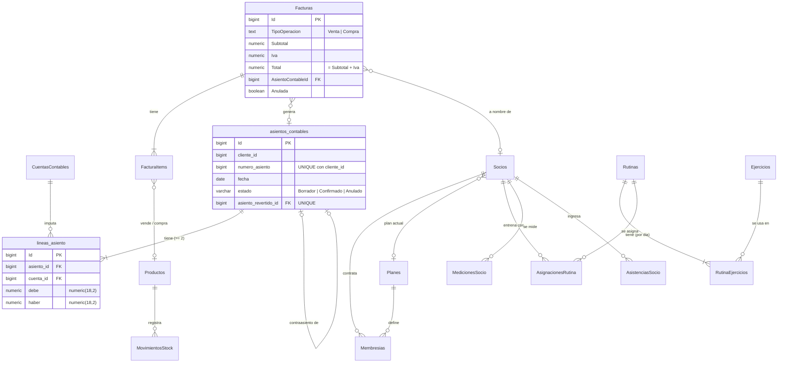

# Base de datos

PostgreSQL. El esquema lo crean las **migraciones de EF Core**
(`backend/src/EstudioContable.Infrastructure/Migrations`), que se aplican solas al
arrancar el backend. Los objetos que EF no sabe generar (triggers, funciones y la
vista) están escritos en SQL en
[`SqlObjetosDeBaseDeDatos.cs`](../backend/src/EstudioContable.Infrastructure/Migrations/SqlObjetosDeBaseDeDatos.cs)
y los aplica la migración `ObjetosDeBaseDeDatos`. De esa forma, lo que se presenta es
exactamente lo que corre.

- Esquema completo generado con `pg_dump`: [`01_esquema_base_datos.sql`](../01_esquema_base_datos.sql)
- Diseño inicial, previo a la implementación: [`diseno_inicial_esquema.sql`](diseno_inicial_esquema.sql)
- Pruebas de las reglas directo contra la base: [`pruebas_base_de_datos.sql`](pruebas_base_de_datos.sql)

## Esquemas

| Esquema | Contenido |
|---|---|
| `contabilidad` | Plan de cuentas, asientos y líneas, facturas, socios, planes, membresías, usuarios, auditoría |
| `caja` / `banco` | Movimientos de tesorería |
| `inventario` | Productos y movimientos de stock |
| `ventas` / `compras` | Facturas de venta y compra del módulo con detalle (legado) |

## Modelo principal



## Integridad

Las reglas de negocio están en el dominio (C#) **y también en la base**, para que no
se puedan saltear con un `INSERT` o `UPDATE` directo.

### Restricciones `CHECK`

| Tabla | Restricción | Regla |
|---|---|---|
| `lineas_asiento` | `CK_lineas_asiento_importes_no_negativos` | `debe >= 0 AND haber >= 0` |
| `lineas_asiento` | `CK_lineas_asiento_debe_o_haber` | La línea va al Debe **o** al Haber, nunca a los dos ni a ninguno |
| `Facturas` | `CK_Facturas_TotalEsSubtotalMasIva` | `Total = Subtotal + Iva` |
| `Facturas` | `CK_Facturas_ImportesNoNegativos` | Subtotal e IVA no negativos |
| `Productos` | `CK_Productos_StockNoNegativo` | `StockActual >= 0` |
| `Planes` | `CK_Planes_Valores` | Duración > 0 y precio >= 0 |
| `Membresias` | `CK_Membresias_Vigencia` | Vencimiento >= inicio |
| `RutinaEjercicios` | `CK_RutinaEjercicios_Dia` / `_Series` / `_Descanso` | Día 1 a 7, series 1 a 20, descanso 0 a 600 s |
| `AsignacionesRutina` | `CK_AsignacionesRutina_Fechas` | Vencimiento >= inicio |
| `movimientos_caja` / `movimientos_banco` | `CK_..._un_solo_tercero` | Un cobro o pago es de un cliente **o** de un proveedor, nunca de los dos |
| `MedicionesSocio` | `CK_MedicionesSocio_Peso` / `_Grasa` / `_Perimetros` | Peso 20 a 400 kg, grasa 2 a 70 %, perímetros dentro de rangos humanos |
| `movimientos_caja` / `movimientos_banco` | `CK_..._importe_positivo` | `Importe > 0` |
| `TurnosEncargado` | `CK_TurnosEncargado_Dia` / `_Hora` | Día 1 a 5 (lunes a viernes) y hora 6 a 21 (turnos de 06:00 a 22:00) |
| `Entrenadores` | `CK_Entrenadores_Nombre` / `CK_Entrenadores_Email` / `CK_Entrenadores_ValorHora` | Nombre no vacío; el email, si está, tiene forma de email (`algo@dominio.ext`, sin espacios); el valor de la hora, si está, va de 0 a 999 999 999 999 |
| `FotosDeEntrenador` | `CK_FotosDeEntrenador_Tamano` | La foto pesa de 100 a 150 000 bytes |
| `HorasDeEntrenador` | `CK_HorasDeEntrenador_Horas` / `CK_HorasDeEntrenador_ValorHora` | Horas de 0 a 24 y de a cuarto de hora (`Horas * 4` entero; 0 = faltó); valor de la hora de 0 a 999 999 999 999 |
| `ConfiguracionDeCopias` | `CK_ConfiguracionDeCopias_Unica` / `_Hora` / `_Minuto` / `_Conservar` / `_DiaSemana` / `_DiaMes` / `_Frecuencia` | Una sola fila (`Id = 1`), hora 0 a 23, minuto 0 a 59, copias a conservar 1 a 60, día de la semana 1 a 7, día del mes 1 a 28 y una de las cinco frecuencias |

### Únicas y claves foráneas

- `asientos_contables (cliente_id, numero_asiento)` único: no se repite la numeración.
- `asientos_contables (asiento_revertido_id)` único: un asiento se revierte una sola vez.
- `Usuario (Email)` único: es el nombre de usuario del login.
- `movimientos_caja` y `movimientos_banco` → `ClientesComerciales` / `Proveedores` (cobros y pagos a cuenta corriente) son
  `RESTRICT`: no se puede borrar un cliente o proveedor que tiene cobros o pagos registrados.
- `MedicionesSocio (SocioId, Fecha)` único: una medición por socio y día.
- `AsistenciasSocio (SocioId, Fecha)` único: un ingreso por socio y día, aunque dos recepciones lo carguen a la vez.
  La FK a `Socios` es `RESTRICT`: no se puede borrar un socio que tiene ingresos. Esta tabla no tiene disparador de
  auditoría (cada fila guarda quién la registró y cuándo).
- `TurnosEncargado (DiaSemana, Hora)` único: un solo entrenador a cargo por día y hora. Es el calendario semanal de
  entrenadores (una fila por celda cargada, sin fechas: se repite todas las semanas) y tiene disparador de auditoría. Su
  `EntrenadorId` es una FK a `Entrenadores` `RESTRICT`: no se puede borrar un entrenador que tiene turnos (por eso un entrenador
  no se borra: se desactiva, y la API lo permite solo si no tiene horas en el calendario).
- `Socios`: el DNI no se repite (índice único `ux_socios_dni`); la aplicación lo controla antes para avisar de quién es, y el índice
  lo garantiza cuando dos altas llegan a la vez.
- `Entrenadores`: nombre único sin distinguir mayúsculas (índice `ux_entrenadores_nombre` sobre `lower("NombreCompleto")`).
  Son fichas sin acceso al sistema (no son filas de `Usuario`). Además del teléfono y la especialidad, guardan un `Email`
  (`varchar(254)`) y un `WhatsApp` (`varchar(30)`), nulos si no se cargaron (el teléfono y el WhatsApp se guardan como `+54 1155551234`: la forma la exige el dominio, no la base), y el `ValorHora` (`numeric(18,2)`, nulo = todavía sin valor), que solo ven y
  cargan el Administrador y el Contador: la API se lo oculta a Recepción. Tiene disparador de auditoría (también del cambio del valor de la hora).
- `FotosDeEntrenador (EntrenadorId)`: la foto de la ficha, una por entrenador (`EntrenadorId` es la clave primaria y una FK a
  `Entrenadores` `ON DELETE CASCADE`), en una columna `Foto` `bytea` con la fecha de la última subida (`Actualizada`). Está **aparte** de
  `Entrenadores` para que la lista y el calendario no carguen imágenes, y **no tiene disparador de auditoría**: el disparador guarda
  la fila entera en cada cambio y copiaría hasta 150 KB por foto en la bitácora. Las altas y bajas de foto se registran como eventos
  (`entrenador` / `FOTO` y `FOTO_BAJA`) desde la API. Entra en la copia de seguridad como cualquier otra tabla.
- `HorasDeEntrenador (EntrenadorId, Fecha)` único (`ux_horas_entrenador_fecha`): las horas que cumplió un entrenador en un día, con un registro por
  entrenador y día. Guarda el `ValorHora` (`numeric(18,2)`) **de ese momento**, copiado de la ficha al crear el día: si el valor del entrenador
  sube después, los días ya cargados no cambian y un presupuesto viejo da siempre lo mismo. `Horas` es `numeric(4,2)`; `Nota`, `varchar(200)`.
  La FK a `Entrenadores` es `RESTRICT`: no se puede borrar a un entrenador que tiene horas. Tiene disparador de auditoría (`trg_auditar_horas_entrenador`)
  y entra en la copia de seguridad como cualquier otra tabla. Solo la gestión la usa (la API no se la da a Recepción).
- `ConfiguracionDeCopias`: **una sola fila** (`Id = 1`, `CHECK` y clave primaria), que la migración deja creada: copia automática apagada,
  diaria a las 22:00 y las últimas 14 copias. Es la programación de las copias automáticas y cómo le fue a la última (`UltimaCopia`,
  `UltimoIntento`, `UltimoError`). Tiene disparador de auditoría y entra en la copia de seguridad como cualquier otra tabla (por eso
  restaurar una copia devuelve también la programación de ese momento).
- `AsignacionesRutina (SocioId)` único **donde Activa**: un socio tiene una sola rutina activa.
- `Ejercicios` y `Rutinas`: nombre único sin distinguir mayúsculas (`lower("Nombre")`).
- Las FK `lineas_asiento → CuentasContables`, `Facturas → asientos_contables` y
  `FacturaItems → Productos` son `RESTRICT`: no se puede borrar algo que está referenciado.

## Triggers

| Trigger | Tabla | Momento | Qué hace |
|---|---|---|---|
| `trg_validar_balance_lineas` / `trg_validar_balance_asiento` | `lineas_asiento`, `asientos_contables` | `AFTER`, **diferido** al `COMMIT` | Un asiento Confirmado debe cumplir la partida doble: Debe = Haber, más de 0 y al menos 2 líneas |
| `trg_proteger_lineas_asiento` / `trg_proteger_asiento` | `lineas_asiento`, `asientos_contables` | `BEFORE UPDATE OR DELETE` | Un asiento Confirmado o Anulado es inmutable: no se borra, no vuelve a Borrador y sus líneas no cambian |
| `trg_auditar_*` (15 tablas) | Facturas, asientos, cuentas, usuarios, planes, socios, productos, ejercicios, rutinas, asignaciones de rutina, mediciones, turnos del calendario de entrenadores, entrenadores, horas de los entrenadores, programación de copias automáticas | `AFTER INSERT OR UPDATE OR DELETE` | Registra el cambio en `contabilidad.auditoria` |
| `trg_auditoria_solo_lectura` / `trg_auditoria_sin_truncate` | `auditoria` | `BEFORE UPDATE OR DELETE` / `BEFORE TRUNCATE` | La auditoría no se puede alterar |

**¿Por qué el trigger de balance es diferido?** Al confirmar una factura se inserta
el asiento y después sus líneas, dentro de la misma transacción. Si se validara fila
por fila, el asiento estaría "desbalanceado" entre una línea y la siguiente. Con
`DEFERRABLE INITIALLY DEFERRED`, la validación corre una sola vez al hacer `COMMIT`,
con el asiento completo. Si no balancea, se revierte toda la transacción.

**¿Cómo se corrige un asiento confirmado?** Se anula: queda en estado Anulado (inmutable) y
deja de sumar en el Diario, el Mayor y el Balance. Es lo que hace el sistema al anular o editar
una factura; ya no genera contraasientos (`asiento_revertido_id` solo conserva los de datos antiguos).

## Auditoría

```
Usuario logueado ──JWT──▶ API ──▶ interceptor de EF: set_config('app.usuario', email),
                                         set_config('app.ip' / 'app.sistema_operativo' / 'app.navegador')
                                         │
                                         ▼
               INSERT/UPDATE/DELETE en tabla auditada ──▶ trigger fn_auditar()
                                                                │
                                                                ▼
                                                  contabilidad.auditoria
```

- `fn_auditar()` guarda la fila **antes y después** (`jsonb`), la lista de
  `campos_modificados`, la tabla, la operación, el usuario y la fecha.
- El usuario sale de `current_setting('app.usuario')`, que la API completa en cada
  conexión ([`AuditoriaConnectionInterceptor`](../backend/src/EstudioContable.Infrastructure/Persistence/AuditoriaConnectionInterceptor.cs)).
  Si el cambio se hace desde un cliente SQL, se registra el usuario de PostgreSQL.
  Como el trigger está en la base, audita cualquier cambio, venga de donde venga.
- Desde qué equipo se hizo el cambio: `ip`, `sistema_operativo` y `navegador` (columnas opcionales, agregadas por la migración
  `AuditoriaConEquipo`; quedan vacías en los registros anteriores y en los cambios hechos desde un cliente SQL). La API las
  informa en `app.ip`, `app.sistema_operativo` y `app.navegador`; el trigger las recorta a 45, 60 y 60 caracteres, así un dato de
  equipo nunca puede hacer fallar el cambio que se audita. La IP sale de la conexión, o de `X-Forwarded-For` si el pedido llega
  de una red de confianza; el sistema operativo y el navegador, del `User-Agent` (que el propio equipo informa).
- Nunca se guarda el hash de la contraseña. Un cambio de contraseña figura como
  campo `Contraseña`. El último acceso de un usuario no genera registro de cambio.
- Los **inicios de sesión** sí quedan registrados, pero por otro camino: los escribe el login, no el trigger, con
  `tabla = 'acceso'` y `operacion` `INGRESO`, `FALLIDO` (clave incorrecta, cuenta inexistente o inactiva) o `BLOQUEADO` (intento
  sobre una cuenta bloqueada). En `usuario` va el email que se probó, sin caracteres de control y de hasta 254 caracteres; nunca
  se guarda la contraseña. Si el registro falla, el login sigue: la auditoría no puede impedir entrar.
- Se consulta desde la pantalla **Auditoría** (solo administradores) o con
  `GET /api/auditoria`.

## Vista y función

**`contabilidad.v_libro_mayor`**: totales de Debe, Haber y saldo por cuenta, tomando
solo los asientos confirmados. La usa `GET /api/asientos/mayor`.

**`contabilidad.fn_sumas_y_saldos(cliente, desde, hasta)`**: balance de sumas y
saldos entre fechas (opcionales). Devuelve todas las cuentas con el saldo expresado
según su naturaleza: Debe − Haber para el Activo, Haber − Debe para Pasivo,
Patrimonio Neto y Resultado. La usan el Balance General (`GET /api/balance`) y el
reporte PDF de Balance.

```sql
SELECT codigo, nombre, saldo_natural
FROM contabilidad.fn_sumas_y_saldos(1, '2026-01-01', '2026-12-31')
WHERE saldo_natural <> 0;
```

## Índices

Además de las PK y de un índice por cada FK, se destacan:

- `asientos_contables (cliente_id, fecha)`: listados del Libro Diario por período.
- `asientos_contables (cliente_id, numero_asiento)` único.
- `lineas_asiento (cuenta_id)`: agregaciones del Mayor y del Balance.
- `auditoria (fecha)` y `auditoria (tabla, registro_id)`: consultar el historial de un registro.

## Transacciones

- Crear, anular o editar una factura toca el asiento, la tesorería y el stock en una
  sola transacción (`FacturacionService`). Si algo falla, no queda nada a medias.
- El cobro de una membresía abre su propia transacción y la facturación participa
  de ella, en lugar de abrir otra.

## Corrección de datos heredados

La migración `ObjetosDeBaseDeDatos`, antes de crear las restricciones, corrige datos
de versiones anteriores que las violaban:

- Borra dos cuentas duplicadas sin movimientos: una "Caja" cargada como Pasivo y
  "IVA a Pagar".
- Pone 1 mes a los planes con duración 0 (quedaron así al renombrar `DuracionDias`
  a `DuracionMeses`).
- Corrige membresías con el vencimiento microsegundos antes del inicio (error de
  cálculo ya corregido en el código).
- Anula referencias huérfanas antes de crear las FK nuevas.

## Cómo probar las reglas

```bash
docker compose exec -T db psql -U postgres -d estudio_contable < docs/pruebas_base_de_datos.sql
```

Intenta violar cada regla (asiento desbalanceado, modificar uno confirmado, factura
con total incorrecto, stock negativo, borrar la auditoría, etc.) e imprime `OK` o
`FALLA` por cada caso. Todo corre dentro de bloques que se deshacen, así que no deja
datos en la base.

## Regenerar `01_esquema_base_datos.sql`

Sobre una base con todas las migraciones aplicadas:

```bash
pg_dump -U postgres -d EstudioContableDB --schema-only --no-owner --no-privileges > 01_esquema_base_datos.sql
```
